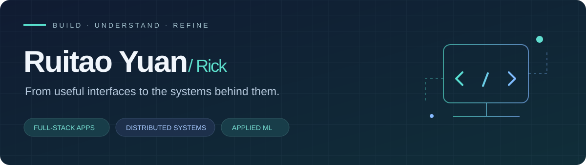
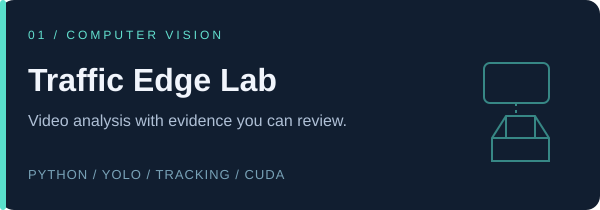
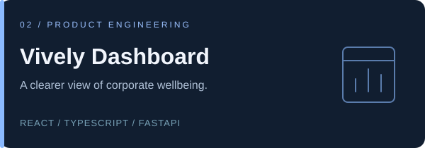

  

### Hi, I'm Rick.

I'm a **University of Sydney student** interested in building useful software from end to end — the interface people interact with, the services behind it, and the tools that help us understand the results.

My projects span **full-stack web development**, **distributed systems**, and **applied machine learning**. I care about clear interfaces, reproducible workflows, and software that is practical to run and maintain.

## Selected work

<table>
<tr>
<td width="50%" valign="top">

**Traffic video → candidate events → human review.**

A research application for fixed-camera traffic footage: vehicle detection and tracking, configurable road geometry, reviewable event evidence, and optional NVIDIA acceleration.

**Explore:** the analysis workflow, annotation protocol, and evaluation tools.

[View project →](https://github.com/Baozouxiaoyuan/traffic-edge-lab)

</td>
<td width="50%" valign="top">

**A corporate dashboard prototype built around aggregate data.**

A React and TypeScript interface for team health metrics, member invitations, activation, and billing. Includes mock API workflows and a lightweight FastAPI backend prototype.

**Explore:** the product interactions, privacy thresholds, and API contract.

[View project →](https://github.com/Baozouxiaoyuan/Vively-Corporate-Wellbeing-Dashboard)

</td>
</tr>
</table>

## Engineering interests

| Area | What I like working on |
| :--- | :--- |
| **Web &amp; product** | React interfaces, Django applications, REST APIs, and usable workflows |
| **Backend &amp; systems** | Java / Spring Boot services, PostgreSQL, RabbitMQ, and Docker |
| **ML &amp; vision** | Python, vehicle detection and tracking, model comparison, and interpretable results |

## How I approach a project

**Understand the problem.** Make the workflow clear before adding complexity.  
**Build across the stack.** Connect product behaviour to the services and data underneath.  
**Make it inspectable.** Write setup instructions, record assumptions, and test the behaviour that matters.

---

Thanks for visiting. Explore the projects above to see what I've been building.

